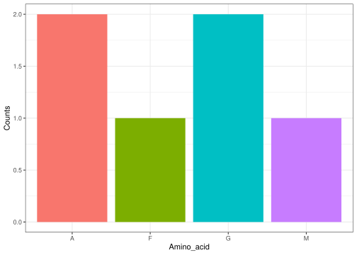
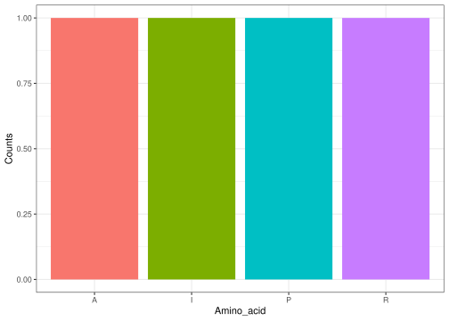

<!-- README.md is generated from README.Rmd. Please edit that file -->

# Introduction

The `centralDogma` package provides simple tools for working with DNA,
RNA, codons, and protein sequences. It is designed to introduce basic
bioinformatics concepts and demonstrate the relationship between DNA,
RNA, and proteins.

GitHub
repository:[https://github.com/group26_package/centralDogma](https://github.com/rforbiodatascience26/group_26_package)

# Using the package

## Generate a random DNA sequence

The `random_dna()` function generates a random DNA sequence of a
specified length.

``` r
dna <- random_dna(12)
dna
#> [1] "GCTCAGTATGAT"
```

## Convert DNA to RNA

The `dna_to_rna()` function converts DNA to RNA by replacing thymine (T)
with uracil (U).

``` r
rna <- dna_to_rna(dna)
rna
#> [1] "GCUCAGUAUGAU"
```

## Split a sequence into codons

The `split_codons()` function divides a sequence into groups of three
bases.

``` r
codons <- split_codons(dna)
codons
#> [1] "GCT" "CAG" "TAT" "GAT"
```

## Translate codons into a protein

The `codons_to_protein()` function translates RNA codons into their
corresponding amino acids.

``` r
protein <- codons_to_protein(c("AUG", "GGC", "UUU"))
protein
#> [1] "MGF"
```

## Plot amino acid frequencies

The `plot_amino_acid_frequency()` function counts the occurrences of
each amino acid in a protein sequence and displays them in a bar plot.

``` r
plot_amino_acid_frequency("AGFAGM")
```



# Combining the functions

The functions can be used together to explore a simple DNA-to-protein
workflow.

``` r
dna <- random_dna(12)
rna <- dna_to_rna(dna)
codons <- split_codons(rna)
protein <- codons_to_protein(codons)

dna
#> [1] "CCCCGGGCGATA"
rna
#> [1] "CCCCGGGCGAUA"
codons
#> [1] "CCC" "CGG" "GCG" "AUA"
protein
#> [1] "PRAI"
plot_amino_acid_frequency(protein)
```



This example generates a DNA sequence, converts it to RNA, splits it
into codons, translates the codons into a protein sequence, and plots
the amino acid frequencies.

# Applications and additions

The package can be used for simple bioinformatics exercises and to learn
how DNA is converted into RNA and proteins. It also helps users explore
codons and the genetic code.

Future improvements could include checking DNA sequences for errors,
generating the complementary DNA strand, and producing RNA from a DNA
template strand. The current `dna_to_rna()` function only replaces T
with U, so it could be improved to create the complementary RNA sequence
using base pairing. Other additions could include finding start and stop
codons and identifying open reading frames.
